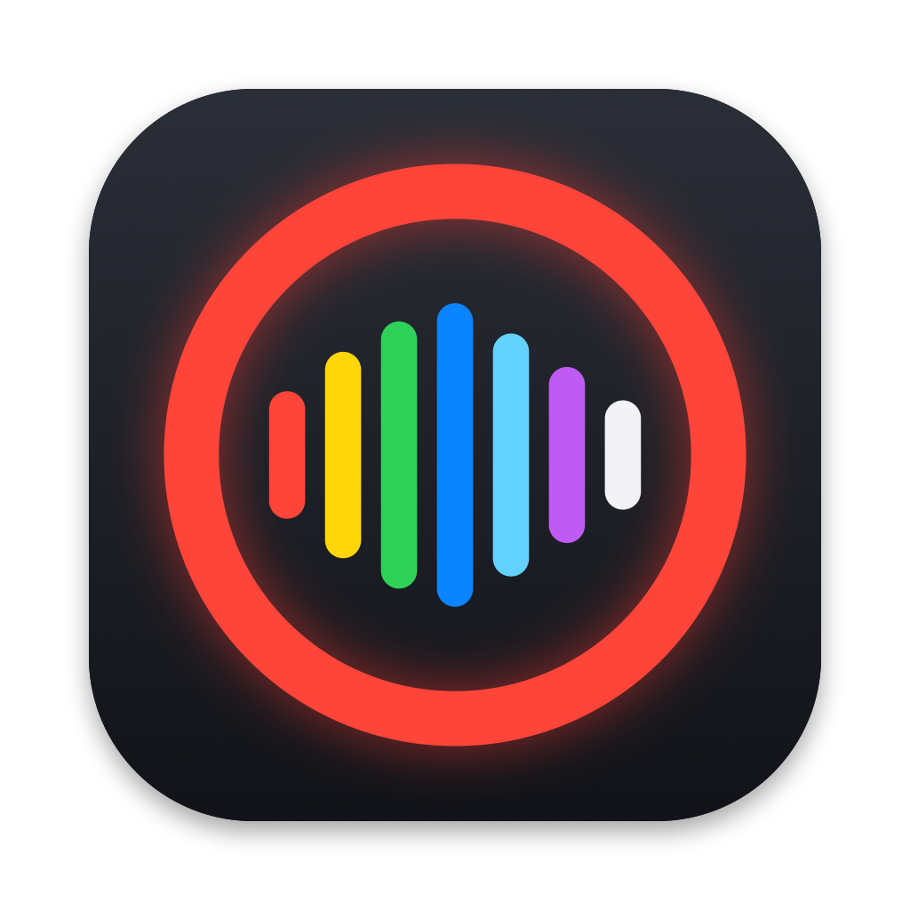
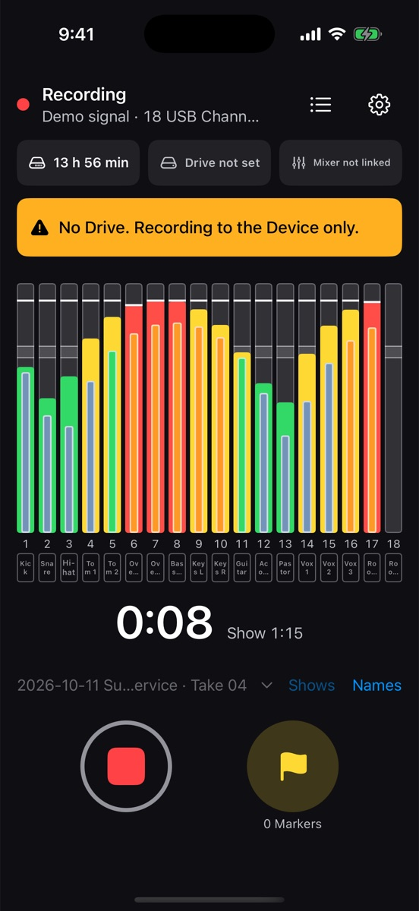
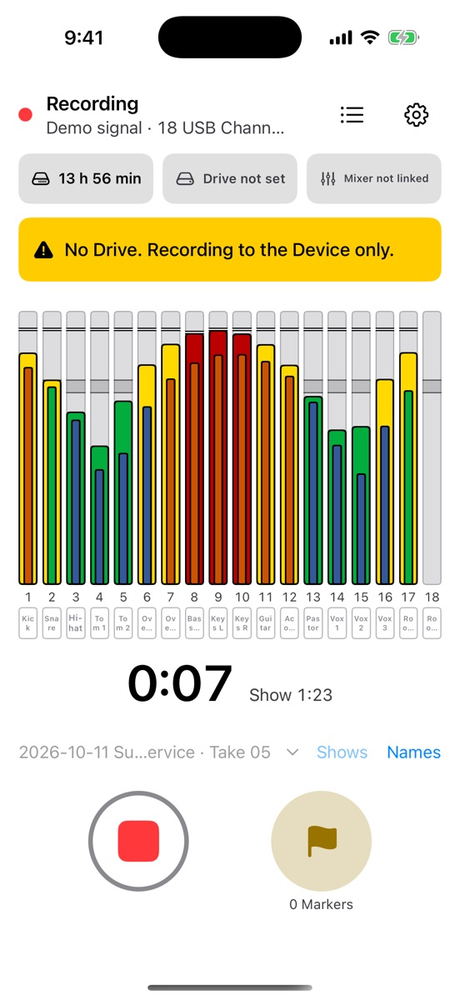
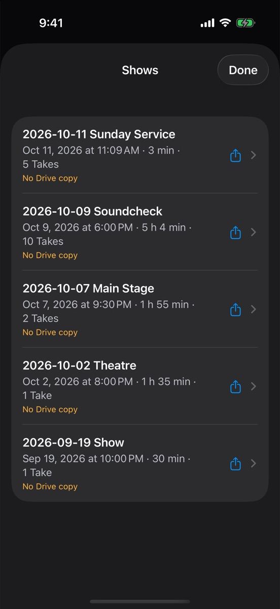

# ShowRecorder

**[Record every channel of your mixer on your phone](https://showrecorder.app).** Plug a [Behringer X Air XR18 or MR18](https://showrecorder.app/mixers/xr18) into an iPhone or iPad, press record, and get one file per channel, named after what's on it, ready for your DAW. No recording laptop at the gig.

> **1.0 for iPhone and iPad is in App Review.** Until it's out, the [public beta on TestFlight](https://testflight.apple.com/join/sSessST8) is open. The Mac app comes to the TestFlight beta first. Website: [showrecorder.app](https://showrecorder.app). Questions: [showrecorder@ericdahl.dev](mailto:showrecorder@ericdahl.dev).

  
  
  

## What you get

- **Every channel, its own file.** One 24-bit Broadcast WAV per USB channel: 18 tracks from an XR18, at the mixer's 48 kHz (up to 96 kHz on interfaces that offer it).
- **Files named from the mixer.** Over Wi-Fi, ShowRecorder reads your channel names and colors, so channel 3 arrives as `03 Snare.wav`, not `USB 03`. Find Mixers locates the XR18 on the network; no IP address to type.
- **A second copy as you record.** Add a USB drive and every Take is written to the phone and the drive at once. If the drive drops out, the missing part is filled back in after the Take.
- **Nothing lost to a crash.** Files are saved every 2 seconds. If the app is closed or crashes mid-Take, it finishes that Take next time it opens. A phone call or another app interrupting the input leaves silence with a Dropout marker, so the files stay in sync with video.
- **Pre-roll.** A Take starts with the seconds before you pressed record, so the count-in isn't lost.
- **Markers.** Tap the flag during a Take to mark a song or a moment. Markers go into the files and your DAW project.
- **Ready to mix.** Each Show gets a report (Takes, levels, any gaps) and a Reaper project with every track and marker in place.
- **Templates for each venue.** Save a room's setup (channel names, mixer, Pre-roll) and start a Show from it in one tap.
- **Built for the stage.** Big meters, a Sunlight appearance for bright stages, a Dark one for dark rooms, and VoiceOver support.

## What you need

| | |
|---|---|
| **A mixer** | Behringer X Air **XR18** or **MR18**: 18 channels over USB, names and colors over Wi-Fi. Other class-compliant USB interfaces record too, without names. |
| **A device** | A USB-C iPhone (15 or later) or an iPad, on iOS or iPadOS 26. The Mac app (macOS 26) is coming through the TestFlight beta. |
| **A hub or cable** | A powered USB-C hub lets the phone charge while the mixer and a drive are plugged in. A Mac just needs the USB cable. |
| **Storage** | About 9.3 GB per hour for 18 channels at 48 kHz. The app shows the time left. A USB drive is optional. |
| **Wi-Fi** | Optional: the phone on the mixer's network gives you channel names and colors. No internet is needed. |

The rigs checked so far are on the [tested hardware](docs/tested-hardware.md) page.

## How a show goes

1. **Plug in** the mixer. ShowRecorder arms it and the meters come alive.
2. **Link the mixer** (Settings > Mixer Link > Find Mixers) to get your channel names, or start from a Template.
3. **Press record.** The Take starts with the Pre-roll before your press. Drop markers as you go.
4. **Press stop.** Your files, the report and the Reaper project are in the Show folder, in the Files app or on your drive.

## The Show-Safe Promise

A Take never stops, and your audio is never held back, because of a trial, a limit or a license. Limits are checked only when you press record. Your past Shows are never locked.

## Free and Pro

ShowRecorder will be a free download with a **14-day Trial** of everything.

- **Free** records 2 USB channels of your choice, with names and colors from the mixer.
- **Pro** is a one-time purchase, shared with your family: every USB channel, channel names you type, the Show report and Reaper project, 96 kHz, and Templates. $19.99.

In the TestFlight beta, the Trial and Pro use sandbox purchases, which cost testers nothing.

## Privacy

ShowRecorder collects no data. Your recordings stay on your device and your drive, and the app only talks to your mixer on your local network. [Privacy policy](https://showrecorder.app/privacy).

## Help

[Support](https://showrecorder.app/support) · [showrecorder@ericdahl.dev](mailto:showrecorder@ericdahl.dev) · [Report a problem](https://github.com/ericdahl-dev/ShowRecorder/issues)

---

**For developers:** building, testing, releasing and how the code is laid out are in [docs/DEVELOPING.md](docs/DEVELOPING.md). The source is available under the [Functional Source License, Version 1.1, MIT Future License](LICENSE.md) (FSL-1.1-MIT): you can read, change and use it for anything except a competing product, and each release becomes MIT two years after it's published ([ADR 0003](docs/adr/0003-fsl-license-app-store.md)). Contributions are welcome; open an issue before starting anything large.

Copyright 2026 Eric Dahl.
